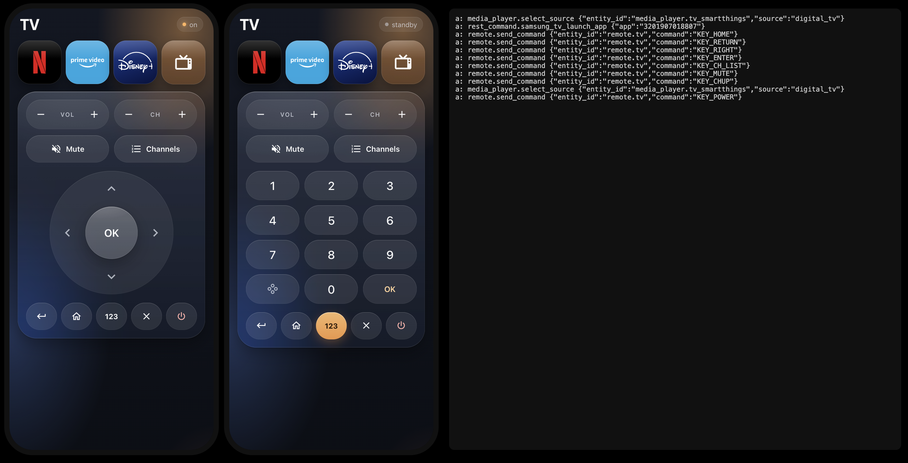

# Glass TV Remote Card

Un telecomando TV a tutto schermo per il telefono, come card Lovelace di
[Home Assistant](https://www.home-assistant.io/). Stile "vetro liquido", scorciatoie alle app che
accendono prima la TV, tastierino numerico su richiesta.

Fatta e provata su una **Samsung QLED 2024** (QE55QE1DAUXZT). Tasti e scorciatoie si cambiano da YAML,
quindi funziona anche con altre TV (vedi [Altre TV](#altre-tv)).

🇬🇧 [English](README.md) — il README inglese è quello di riferimento (tabella completa delle opzioni).



## Cosa fa
- **Telecomando**: bilancieri VOL e CH, Muto, Lista canali, d-pad circolare con OK, Indietro / Home / Esci / Power.
- **Tastierino** ("123"): sostituisce solo il d-pad, il resto resta dove il pollice se lo aspetta.
- **Scorciatoie** (Netflix, Prime Video, Disney+, Canali TV, quello che vuoi): se la TV è spenta la card
  la accende, aspetta che sia accesa davvero e poi apre l'app. Sull'icona compare lo stato.
- **Intestazione** con lo stato della TV (accesa / standby).
- Web Component senza build, senza dipendenze, senza token e senza polling (solo l'oggetto `hass`).

## Installazione
**HACS** (repository personalizzato): HACS → ⋮ → *Repository personalizzati* → URL di questo repo, tipo
*Dashboard* → installa *Glass TV Remote Card* → ricarica il browser.

**A mano**: copia `glass-tv-remote-card.js` in `/config/www/`, poi *Impostazioni → Plance → ⋮ →
Risorse → Aggiungi*: URL `/local/glass-tv-remote-card.js`, tipo *Modulo JavaScript*.

Consiglio: metti la card da sola in una vista di tipo **Pannello** e aprila dal telefono.

## Samsung QLED 2024
Esempio completo: [`examples/samsung-qled-2024.yaml`](examples/samsung-qled-2024.yaml).

Serve l'integrazione **Samsung Smart TV** (`samsungtv`), che crea un'entità `remote.*` e una
`media_player.*`. I tasti partono con `remote.send_command` e i codici Samsung `KEY_*`, che sono i
default della card.

Su questo modello tre cose **non** funzionano, e hanno deciso come è fatta la card:

| Cosa dice la documentazione | Cosa succede sulla QLED 2024 | Cosa fa la card |
|---|---|---|
| `media_player.turn_on` (Wake-on-LAN) per accendere | la TV resta in standby | manda `KEY_POWER` e aspetta che il `media_player` sia `on` (~10 s) |
| `media_player.play_media` con tipo `app` | il servizio risponde ok ma non si apre niente | chiama l'**API REST locale** della TV con un `rest_command` |
| `KEY_TV` / `KEY_DTV` o sorgente `TV` per i canali | ignorati | `media_player.select_source` `digital_tv` sull'entità **SmartThings** della stessa TV |

**1. Avvio delle app — in `configuration.yaml`** (IP della tua TV, meglio se fisso):
```yaml
rest_command:
  samsung_tv_launch_app:
    url: "http://192.0.2.10:8001/api/v2/applications/{{ app }}"
    method: post
    timeout: 8
```
**2. Canali TV (facoltativo)**: aggiungi l'integrazione **SmartThings**. Porta con sé anche gli altri
dispositivi SmartThings: i doppioni si possono disattivare tenendo solo la TV.

**Trovare l'ID di un'app.** Le app Samsung hanno un ID numerico. Chiedi alla TV se è installata:
```bash
curl http://192.0.2.10:8001/api/v2/applications/3201907018807
# installata → JSON con "name", "running", "visible";  non installata → 404
```
ID verificati sulla nostra TV (ottobre 2026): Netflix `3201907018807` · Prime Video `3201910019365` ·
Disney+ `3201901017640`.

## Come sono fatte le scorciatoie
Ogni scorciatoia è un'icona e fa **una** di queste cose (vince la prima presente):
`service` + `data` (qualsiasi servizio di HA) · `key` (un tasto: nome logico o codice grezzo) ·
`source` (`media_player.select_source`) · `app` (l'ID passato a `rest_command.samsung_tv_launch_app`).

Il pulsante **è** l'icona dell'app: un quadrato arrotondato nel colore del marchio con il logo in
monocromo e un riflesso di vetro sopra. `brand: netflix | prime | disney` usa i loghi inclusi;
`icon: mdi:...` disegna un'icona Material su vetro; per un logo tuo passa a `brand` un oggetto con
`bg`, `fg`, `vb` (viewBox SVG), `pad` e `d` (il path, per esempio da [Simple Icons](https://simpleicons.org/)).

## Altre TV
Alla card serve solo un servizio che accetti il nome di un tasto. Cambia `send` e `keys`, nascondi con
`null` quello che la tua TV non ha e punta le scorciatoie a ciò che offre la tua integrazione.
Esempi per **LG webOS** e **Roku** nel [README inglese](README.md#other-tvs) (non provati dall'autore:
i nomi dei tasti vengono dalla documentazione di HA).

| Pulsante | Nome in `keys:` | Default (Samsung) |
|---|---|---|
| Power | `power` | `KEY_POWER` |
| Volume + / − | `vol_up` / `vol_down` | `KEY_VOLUP` / `KEY_VOLDOWN` |
| Canale + / − | `ch_up` / `ch_down` | `KEY_CHUP` / `KEY_CHDOWN` |
| Muto | `mute` | `KEY_MUTE` |
| Lista canali | `ch_list` | `KEY_CH_LIST` |
| D-pad | `up` `down` `left` `right` | `KEY_UP` `KEY_DOWN` `KEY_LEFT` `KEY_RIGHT` |
| OK | `ok` | `KEY_ENTER` |
| Indietro / Home / Esci | `back` / `home` / `exit` | `KEY_RETURN` / `KEY_HOME` / `KEY_EXIT` |
| Cifre | `num_0` … `num_9` | `KEY_0` … `KEY_9` |

## Anteprima senza Home Assistant
```bash
python3 -m http.server      # dalla radice del repo
# apri http://localhost:8000/examples/preview.html
```

## Licenza
MIT — vedi [LICENSE](LICENSE). I loghi sono marchi dei rispettivi proprietari.
