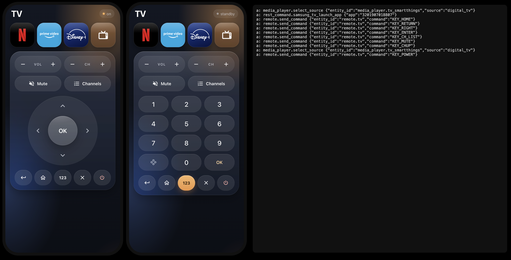

# Glass TV Remote Card

A full-screen TV remote for your phone, as a [Home Assistant](https://www.home-assistant.io/) Lovelace card.
"Liquid glass" look, one-tap app shortcuts that wake the TV first, number pad on demand.

Built and tested on a **Samsung QLED 2024** (QE55QE1DAUXZT). Every key and shortcut can be
remapped from YAML, so it works with other TVs too (see [Other TVs](#other-tvs)).

🇮🇹 [Leggi in italiano](README.it.md)

<!-- Screenshot: open examples/preview.html (see "Preview") and save it as docs/screenshot.png -->


## Features
- **Remote**: VOL and CH rockers, Mute, Channel list, round d-pad with OK, Back / Home / Exit / Power.
- **Number pad** ("123"): replaces only the d-pad, so the rest of the remote stays where your thumb expects it.
- **Shortcuts** (Netflix, Prime Video, Disney+, Live TV, anything): if the TV is off, the card turns it on,
  waits until it is really on, then opens the app. Status pill on the icon: *waking… / opening… / failed*.
- **Header** with the TV state (on / standby).
- Vanilla Web Component: no build step, no dependencies, no token, no polling (only the `hass` object).
- Haptic tick on Android (Vibration API).

## Installation
**HACS** (custom repository): HACS → ⋮ → *Custom repositories* → this repo URL, type *Dashboard* →
install *Glass TV Remote Card* → reload the browser.

**Manual**: copy `glass-tv-remote-card.js` to `/config/www/`, then *Settings → Dashboards → ⋮ →
Resources → Add*: URL `/local/glass-tv-remote-card.js`, type *JavaScript module*.

Tip: put the card alone in a view of type **Panel** and open it from your phone.

## Samsung QLED 2024 setup
Full example: [`examples/samsung-qled-2024.yaml`](examples/samsung-qled-2024.yaml).

You need the **Samsung Smart TV** integration (`samsungtv`), which creates a `remote.*` and a
`media_player.*` entity. Keys are sent with `remote.send_command` and Samsung `KEY_*` codes, which are
the card's defaults.

Three things did **not** work on this model and shaped the design:

| What the docs suggest | What happens on the QLED 2024 | What the card does |
|---|---|---|
| `media_player.turn_on` (Wake-on-LAN) to wake the TV | the TV stays in standby | sends `KEY_POWER`, then waits for the `media_player` to be `on` (~10 s) |
| `media_player.play_media` with `media_content_type: app` | the service answers OK, nothing opens | calls the TV's **local REST API** through a `rest_command` |
| `KEY_TV` / `KEY_DTV` or source `TV` for live TV | ignored | `media_player.select_source` `digital_tv` on the **SmartThings** entity of the same TV |

**1. App launching — add this to `configuration.yaml`** (use your TV's IP, ideally a fixed DHCP lease):
```yaml
rest_command:
  samsung_tv_launch_app:
    url: "http://192.0.2.10:8001/api/v2/applications/{{ app }}"
    method: post
    timeout: 8
```
**2. Live TV (optional)**: add the **SmartThings** integration. It will bring in your other SmartThings
devices too; you can disable the duplicates and keep only the TV.

**Finding app IDs.** Samsung apps have numeric IDs. Ask the TV whether one is installed:
```bash
curl http://192.0.2.10:8001/api/v2/applications/3201907018807
# installed → JSON with "name", "running", "visible";  not installed → 404
```
IDs verified on our TV (October 2026): Netflix `3201907018807` · Prime Video `3201910019365` ·
Disney+ `3201901017640`. IDs of other apps can be found online (search for "Samsung Tizen app ID");
check them with the command above.

## Configuration
```yaml
type: custom:glass-tv-remote-card
remote: remote.samsung_tv
media_player: media_player.samsung_tv
shortcuts:
  - {name: Netflix, brand: netflix, app: "3201907018807"}
```

| Option | Default | Description |
|---|---|---|
| `remote` | — (required, unless `send.target`) | Entity that receives the keys |
| `media_player` | none | Shows on/standby in the header; shortcuts wake the TV and wait for `on`. Without it, shortcuts run immediately |
| `name` | `TV` | Header title |
| `keys` | Samsung `KEY_*` | Remap buttons, see below. `null` hides a button |
| `numpad` | `true` | `false` hides the "123" button |
| `send.service` | `remote.send_command` | Service used to send a key |
| `send.field` | `command` | Service field that carries the key |
| `send.target` | `remote` | `entity_id` passed to that service |
| `send.data` | `{}` | Extra fields added to every key call |
| `shortcuts` | none | Icons on top, see below |
| `app_service` | `rest_command.samsung_tv_launch_app` | Called as `{app: <id>}` by `app:` shortcuts |
| `power_on` | `{key: power}` | How shortcuts wake the TV: `{key: <button or code>}` or `{service: media_player.turn_on, data: {...}}` (the `media_player` is passed as `entity_id`) |

### Buttons and default keys
| Button | Name in `keys:` | Default (Samsung) |
|---|---|---|
| Power | `power` | `KEY_POWER` |
| Volume + / − | `vol_up` / `vol_down` | `KEY_VOLUP` / `KEY_VOLDOWN` |
| Channel + / − | `ch_up` / `ch_down` | `KEY_CHUP` / `KEY_CHDOWN` |
| Mute | `mute` | `KEY_MUTE` |
| Channels | `ch_list` | `KEY_CH_LIST` |
| D-pad | `up` `down` `left` `right` | `KEY_UP` `KEY_DOWN` `KEY_LEFT` `KEY_RIGHT` |
| OK | `ok` | `KEY_ENTER` |
| Back / Home / Exit | `back` / `home` / `exit` | `KEY_RETURN` / `KEY_HOME` / `KEY_EXIT` |
| Digits | `num_0` … `num_9` | `KEY_0` … `KEY_9` |

A rocker disappears when both its keys are `null`.

### Shortcuts
Each shortcut is one icon. It does **one** of these (first match wins):

| Field | Does |
|---|---|
| `service` + `data` | Calls any Home Assistant service |
| `key` | Sends a key (a button name from the table above, or a raw code like `KEY_SOURCE`) |
| `source` (+ `entity`) | `media_player.select_source` on `entity` (default: `media_player`) |
| `app` | Calls `app_service` with `{app: <id>}` (Samsung REST API) |

**How they look.** The button *is* the app icon: a rounded square in the brand colour with a monochrome
logo, and a glass highlight on top.
- `brand: netflix | prime | disney` uses the built-in logos.
- `icon: mdi:...` draws a Material Design icon on glass instead.
- Your own logo: pass an object to `brand` with a background, a fill colour, the SVG `viewBox` and one or
  more paths (for example from [Simple Icons](https://simpleicons.org/)):
  ```yaml
  - name: YouTube
    app: "111299001912"
    brand:
      bg: "#ff0000"
      fg: "#fff"
      vb: "0 0 24 24"
      pad: 14            # inner padding in px
      d: "M23.498 6.186a3.016 ..."   # the SVG path (string or list)
  ```
Up to 4 icons per row; more wrap to a new row.

## Other TVs
The card only needs a service that accepts a key name. Change `send` and `keys`, hide what your TV
does not have, and point the shortcuts to whatever your integration offers.

> ⚠️ The examples below are **not tested** by the author (only the Samsung one is): key names come from
> the Home Assistant integration docs, check them for your model.

**LG webOS** ([docs](https://www.home-assistant.io/integrations/webostv/)) — keys go through `webostv.button`:
```yaml
type: custom:glass-tv-remote-card
media_player: media_player.lg_tv
send: {service: webostv.button, field: button, target: media_player.lg_tv}
keys:
  power: null               # no power button in webostv.button
  vol_up: VOLUMEUP
  vol_down: VOLUMEDOWN
  mute: MUTE
  ch_up: CHANNELUP
  ch_down: CHANNELDOWN
  ch_list: null
  up: UP
  down: DOWN
  left: LEFT
  right: RIGHT
  ok: ENTER
  back: BACK
  home: HOME
  exit: EXIT
  num_0: "0"
  num_1: "1"
  num_2: "2"
  num_3: "3"
  num_4: "4"
  num_5: "5"
  num_6: "6"
  num_7: "7"
  num_8: "8"
  num_9: "9"
power_on: {service: media_player.turn_on}   # needs the webOS "turn on" automation / Wake-on-LAN
shortcuts:
  - {name: Netflix, brand: netflix, source: Netflix}
```

**Roku** ([docs](https://www.home-assistant.io/integrations/roku/)) — `remote.send_command`:
```yaml
type: custom:glass-tv-remote-card
remote: remote.roku
media_player: media_player.roku
numpad: false
keys:
  power: power
  vol_up: volume_up
  vol_down: volume_down
  mute: volume_mute
  ch_up: channel_up
  ch_down: channel_down
  ch_list: null
  up: up
  down: down
  left: left
  right: right
  ok: select
  back: back
  home: home
  exit: null
power_on: {key: power}
shortcuts:
  - {name: Netflix, brand: netflix, source: Netflix}
```

**Any other TV**: look in *Developer tools → Actions* for the service your integration uses to send
remote keys, and in its docs for the key names. If the TV has no remote entity at all, `send.service`
can be a script that receives the key as a field.


## Troubleshooting
- **Shortcut says "TV off"**: the TV did not reach `on` within 25 s. Check that the power key works from
  the remote, and that `media_player` is the entity that really follows the TV (some setups have a stale
  duplicate that is always `unavailable`).
- **Shortcut says "failed"**: the service call was rejected; the browser console shows the error.
  For `app:` shortcuts, check that the `rest_command` exists and the TV IP is right.
- **App opens nothing**: the app ID is wrong or the app is not installed (`curl` above → 404).

## License
MIT — see [LICENSE](LICENSE). Logos are trademarks of their owners.
